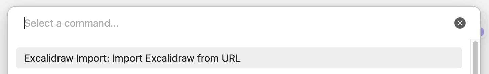
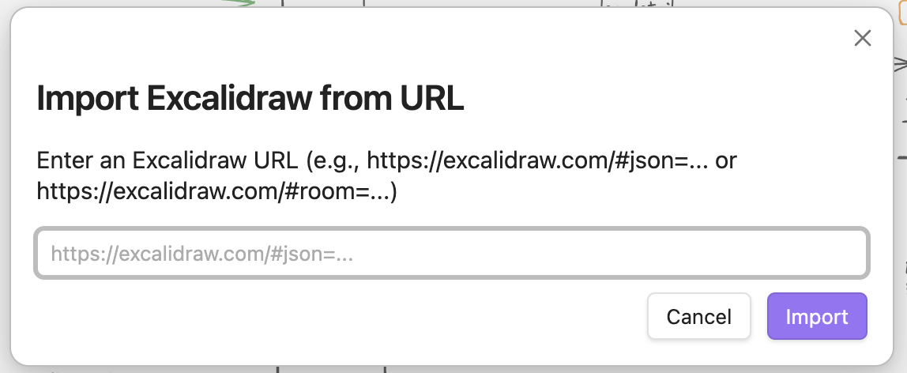
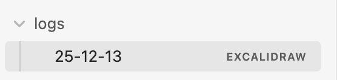

# Excalidraw Import

Import Excalidraw scenes from [excalidraw.com](https://excalidraw.com) share links directly into your Obsidian vault.

## Features

- Import scenes shared via a link: `https://excalidraw.com/#json=ID,KEY`
- Import collaboration rooms: `https://excalidraw.com/#room=ROOM_ID,KEY` (if the room is saved on the server)
- Configurable target folder (`logs` by default, empty means vault root)
- Automatic file naming: `YY-MM-DD.excalidraw` (a numeric suffix is added if the file already exists)

The resulting `.excalidraw` files can be opened with the [Excalidraw](https://github.com/zsviczian/obsidian-excalidraw-plugin) plugin.

## Installation

### From Community plugins

1. Open **Settings → Community plugins → Browse**
2. Search for **Excalidraw Import**
3. Click **Install**, then **Enable**

### Manual

1. Download `main.js`, `manifest.json` and `styles.css` from the [latest release](https://github.com/avonar/obsidian-excalidraw-import/releases/latest)
2. Put them into `<your vault>/.obsidian/plugins/excalidraw-import/`
3. Reload Obsidian and enable the plugin in **Settings → Community plugins**

## Usage

1. Open the command palette (`Cmd+P` on Mac, `Ctrl+P` on Windows/Linux)
2. Run **Excalidraw Import: Import Excalidraw from URL**
   <details>
   <summary>Show image</summary>
   
   </details>
3. Paste the URL of the Excalidraw scene, for example:
   - `https://excalidraw.com/#json=iZjneM_FyVAopRFr6j0HR,oUua4UgiBHpuehmPsp3MCg`
   - `https://excalidraw.com/#room=f15d632f15a515ddfcfd,Uak2P-GzHSXNH39tBSBfuQ`
   <details>
   <summary>Show image</summary>
   
   </details>
4. Press **Import** (or `Enter`)
5. The file is saved to the configured folder with a name like `YY-MM-DD.excalidraw`
   <details>
   <summary>Show image</summary>
   
   </details>

## Settings

- **Save folder** — folder where imported files are saved. Leave empty to save to the vault root.

## Network usage

This plugin makes network requests only when you run the import command, and only to download the scene you pasted:

- `#json=` links: the encrypted scene is downloaded from `https://json.excalidraw.com` (the official Excalidraw share backend).
- `#room=` links: the encrypted room snapshot is read from Excalidraw's public Firebase project (`excalidraw-room-persistence`).

Decryption happens locally using the key from the URL fragment; the key is never sent anywhere. No telemetry, no accounts, no other data is collected or transmitted.

## Development

```bash
npm install     # install dependencies
npm run dev     # build with inline source maps
npm run build   # production build
npm test        # run tests (downloads sample scenes from excalidraw.com)
```

## License

[MIT](LICENSE)
